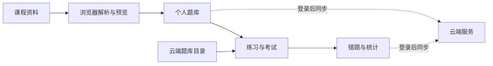

# 题目练习器

把课程资料变成可以反复练习的题库。支持按章节练习、模拟考试、错题回顾、知识点整理，以及从 PDF、Word 和纯文本导入题目。

[在线体验](https://quiz-bank-pro.app.workbuddy.host/) · [快速开始](#快速开始) · [项目结构](#项目结构)

> 当前仓库展示前端实现。在线体验使用的服务端和题库数据独立维护，因此线上页面与仓库版本可能有差异。

## 能做什么

| 场景 | 功能 |
| --- | --- |
| 找题练习 | 搜索题库、按章节和题型筛选、顺序或随机作答 |
| 复习巩固 | 模拟考试、背题、错题本、学习统计和进度续做 |
| 导入资料 | 解析 PDF、DOCX、TXT；预览题目与答案后再保存 |
| AI 辅助 | 整理知识点和辅助解析；调用额度由云端管理 |
| 账号同步 | 登录后同步个人题库、练习进度和兑换记录 |

## 快速开始

项目是原生 HTML、CSS 和 JavaScript，无需安装前端依赖或执行构建。

```bash
git clone https://github.com/star1-top/question-practice-app.git
cd question-practice-app/app
python3 -m http.server 8765
```

打开 <http://localhost:8765>。本地导入和练习可以直接体验；登录、云端题库、同步和 AI 功能依赖 `app/assets/config.js` 指向的云端服务。部分登录流程可能要求在服务端配置本地域名。

运行导入逻辑测试：

```bash
node tests/import.test.cjs
```

## 项目结构

```text
app/
  index.html          页面入口
  assets/
    app.js            练习、题库和页面交互
    cloud.js          登录与云端数据接口
    parse.js          PDF、Word、文本题目解析
    ai.js             AI 辅助功能
    style.css         基础样式
    design.css        视觉样式
    vendor/           随项目分发的前端依赖
tests/
  import.test.cjs     导入与长文本处理测试
```

## 实现思路



- **浏览器侧解析**：先识别题目、选项和答案，再让用户检查导入结果，避免直接覆盖已有题库。
- **按需加载**：先加载题库目录，进入题库时再请求正文。
- **进度保护**：练习状态先保存在本机；登录后与云端同步，网络失败不会中断当前作答。
- **服务端计费**：解锁、兑换和 AI 次数变更通过云端接口处理，前端不直接修改余额。

## 公开范围

仓库包含前端源码和测试。云端数据库、完整题库原始资料及运营记录由项目单独维护。`app/assets/config.js` 中的 `publishableKey` 是浏览器使用的公开接入键；服务端权限仍由云端校验。

## 当前状态

这是持续迭代的学习项目。导入逻辑有自动化测试；云端登录、付费解锁和跨设备同步需要在对应服务环境中验证。题目与答案仍需持续人工复核，使用时请以课程资料为准。
