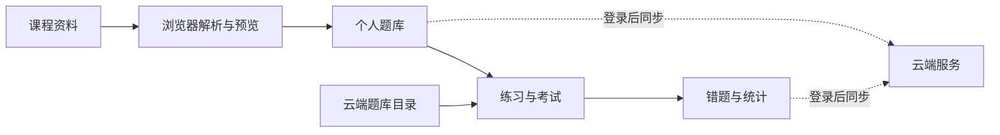

# 题目练习器｜大学生网课题库与期末复习

面向大学生网课和通识课复习的 Web 题库工具。把“找题、做题、核对答案、回看错题”放进同一个练习流程：可以从题库广场选课程，也可以把手头的课程资料导入为自己的题库。

期末复习时，先按章节查漏补缺，再用随机练习和模拟考试检验掌握情况；做错的题会进入错题本，方便集中重练。项目还提供背题、学习统计和知识点整理，帮助把一次性刷题变成有记录、能回顾的复习过程。

[在线体验](https://quiz-bank-pro.app.workbuddy.host/?sharecode=2LTZZGMAB7) · [快速开始](#快速开始) · [项目结构](#项目结构)

> 当前仓库展示前端实现。在线体验使用的服务端和题库数据独立维护，因此线上页面与仓库版本可能有差异。题库覆盖范围取决于线上数据；题目和答案仍需结合课程资料核对。

## 适合的复习场景

1. **跟着网课进度练**：找到对应课程，按章节和题型筛选题目，做完一轮就能看到答题结果。
2. **考前集中查漏**：用错题本重练薄弱题目，再切换随机练习或模拟考试，减少只记住题目顺序的影响。
3. **整理自己的资料**：导入 PDF、Word 或文本，检查识别出的题干、选项和答案，再保存为个人题库。

本项目希望让复习材料更容易使用，不保证题库覆盖每门课程，也不把练习结果等同于考试成绩。

## 能做什么

| 场景 | 功能 |
| --- | --- |
| 找题练习 | 搜索题库、按章节和题型筛选、顺序或随机作答 |
| 复习巩固 | 模拟考试、背题、错题本、学习统计和进度续做 |
| 导入资料 | 解析 PDF、DOCX、TXT；预览题目与答案后再保存 |
| AI 辅助 | 整理知识点和辅助解析；调用额度由云端管理 |
| 账号同步 | 登录后同步个人题库、练习进度和兑换记录 |

## 题目纠错

登录用户在练习页可提交建议答案或题干、选项修正文字，并可附一张裁剪后的学习通截图。上传前浏览器会把图片缩至最长边 1800 像素并转为 JPEG；截图保存在当前用户的私有云端路径。用户可主动点「AI 识别截图」，核对识别出的题干和明确标出的答案，再决定是否填入建议答案。AI 不根据截图自行解题，也不直接修改共享题库。

部署纠错功能时，在受保护的云端 SQL 控制台依次执行 `server/04-question-reports.sql`、`server/05-question-report-evidence.sql`、`server/06-apply-question-correction.sql`，并确认平台运行时存储允许登录用户写入自己的 `users/<uid>/question-reports/` 路径。审核者检查原截图与课程资料后，可通过受保护的 `quiz_apply_question_report(report_id, final_answer, final_stem)` 函数精确应用答案或题干修正。选项修正、重复题和个人题库的报告仍需人工处理。用户重新进入题库时会拉取最新正文。

练习页提供「日积月累」和「考前冲刺」两种模式：前者每轮最多 10 题，优先选择未做过的题；后者以整套题库所有题目至少作答一次为一轮，支持跨天续做，并根据目标考试日期显示每日建议题量。两种模式的进度分别保存在题库练习记录中。

付费题库点击后先显示公开预览，再进入登录和解锁流程。课程名、学校、题数与章节数来自线上目录；章节目录和每套 2 道真实样题来自 `app/assets/previews.js`，因此直接打开本地 `index.html` 也能查看。目前包含 39 套付费题库的预览，公开文件不包含完整付费题库。原始资料未提供解析，预览页会如实说明。

更新线上题库时，先导出当前**可见**的目录条目，再用 `scripts/build_catalog_previews.py` 从已核对的私有题库备份重新生成公开预览。脚本会检查 ID、题数、题干、选项和答案格式，并跳过需要配图的题目；发布前仍应人工抽看样题内容。不要把私有备份或完整收费题库复制到 `app/`。

## 快速开始

项目是原生 HTML、CSS 和 JavaScript，无需安装前端依赖或执行构建。

```bash
git clone https://github.com/star1-top/question-practice-app.git
cd question-practice-app/app
python3 -m http.server 8765
```

打开 <http://localhost:8765>。本地导入和练习可以直接体验；登录、云端题库、同步和 AI 功能依赖 `app/assets/config.js` 指向的云端服务。部分登录流程可能要求在服务端配置本地域名。

运行导入逻辑测试：

```bash
node tests/import.test.cjs
```

## 项目结构

```text
app/
  index.html          页面入口
  assets/
    app.js            练习、题库和页面交互
    cloud.js          登录与云端数据接口
    parse.js          PDF、Word、文本题目解析
    ai.js             AI 辅助功能
    style.css         基础样式
    design.css        视觉样式
    vendor/           随项目分发的前端依赖
tests/
  import.test.cjs     导入与长文本处理测试
```

## 实现思路



- **浏览器侧解析**：先识别题目、选项和答案，再让用户检查导入结果，避免直接覆盖已有题库。
- **按需加载**：先加载题库目录，进入题库时再请求正文。
- **进度保护**：练习状态先保存在本机；登录后与云端同步，网络失败不会中断当前作答。
- **服务端计费**：解锁、兑换和 AI 次数变更通过云端接口处理，前端不直接修改余额。

## 公开范围

仓库包含前端源码和测试。云端数据库、完整题库原始资料及运营记录由项目单独维护。`app/assets/config.js` 中的 `publishableKey` 是浏览器使用的公开接入键；服务端权限仍由云端校验。

## 当前状态

这是持续迭代的学习项目。导入逻辑有自动化测试；云端登录、付费解锁和跨设备同步需要在对应服务环境中验证。题目与答案仍需持续人工复核，使用时请以课程资料为准。
